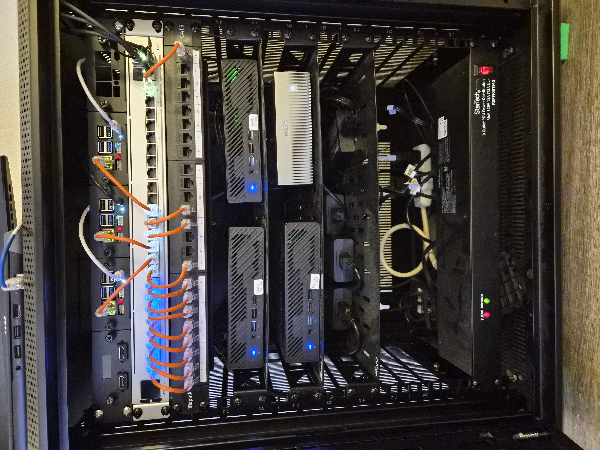
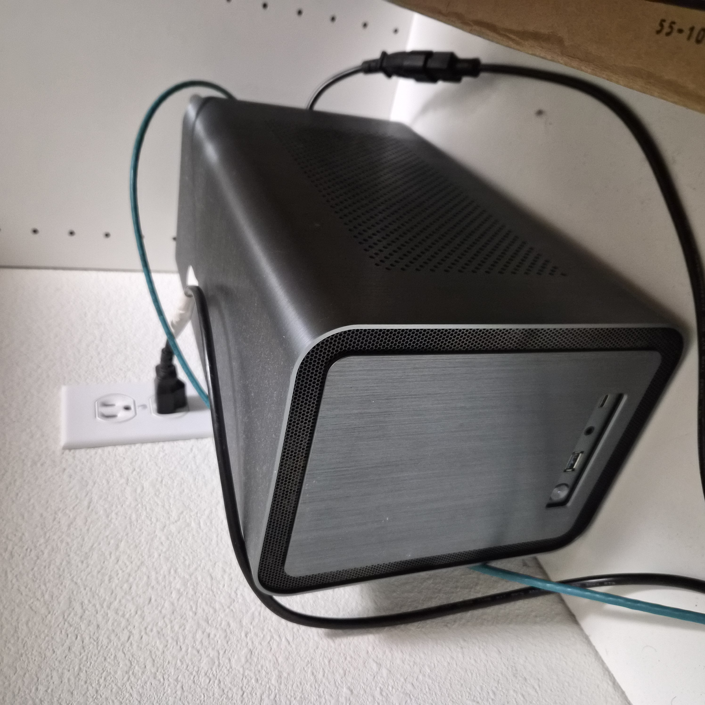
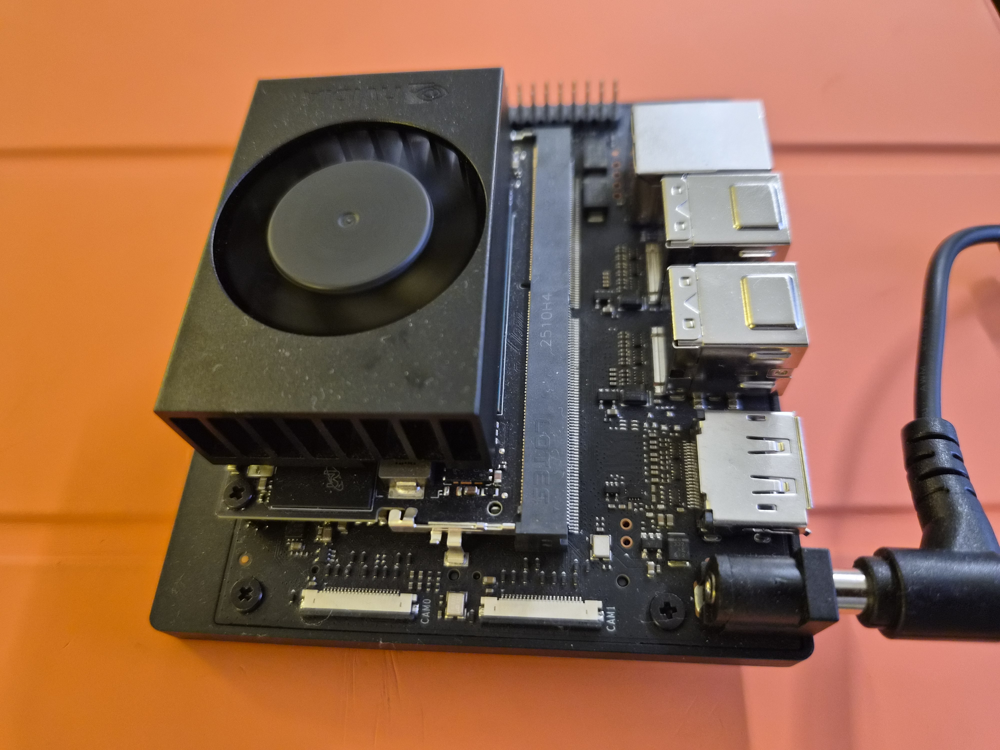
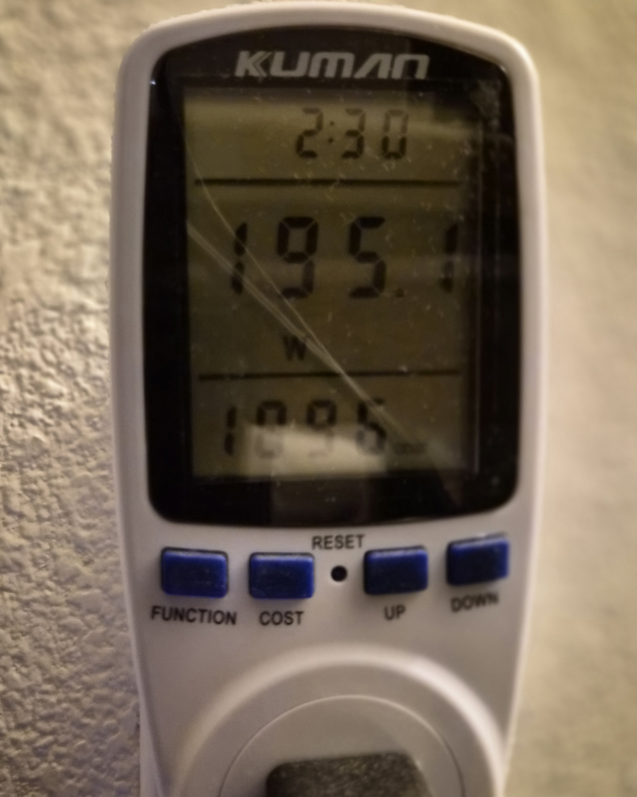

I wanted a homelab where I could experiment and break things without worrying about how long it would take to rebuild. I had three Minisforum MS-01s, a Dell Inspiron laptop gathering dust, and a couple of Raspberry Pis that I had picked up for automation and AI projects, including experiments with the AI HAT+. Three MS-01s were enough for most cluster designs, but reinstalling an OS across all three every time got old. Inspired by production private-cloud environments, I decided to make most of my compute available on demand through PXE. Today, that lab runs a Canonical OpenStack cluster.

## The Bootstrap Problem

My homelab has a chicken-and-egg problem. I want MAAS (Metal as a Service) to manage the machines, but MAAS needs a place to run. I also want Landscape to monitor and update them, but its server needs a home too. If each foundational service requires another bootstrap layer, I spend more time rebuilding the platform than using it across projects.

My answer is a three-tier chain. The only machines I install by hand in that chain are three Raspberry Pi 5s; I started with two and added a third so I could cluster them. From there, MAAS provisions the Dell and the three MS-01s over PXE, including the machine that deploys OpenStack. If I wiped that x86 tier tomorrow, I could bring it back without plugging in a USB stick.

## Tier 0: The Raspberry Pis

The three Pi 5s run Ubuntu Core with MicroCloud. Ubuntu Core gives me a transactional, snap-based base system that is difficult to break accidentally. MicroCloud gives me a clustered LXD environment across the three nodes without the overhead of full virtual machines. On that cluster, I run MAAS, Landscape Server, Docker inside a system container (yes, nested containerization), and a few other services I want to keep stable.

MAAS runs on the Pis for a practical reason: it is not a high-frequency workload, and I want the provisioner on the lowest-power machines with the fewest moving parts. Three Pis draw only a handful of watts each and avoid making one x86 box the single machine that everything else needs in order to boot. The three-node MicroCloud layer can remain available if one Pi goes down, although each workload still needs its own redundancy plan.

## Tier 1: The Dell Inspiron

Once MAAS is online, it can PXE-boot and commission an x86 node, deploy Ubuntu, and make the machine available to Juju. My first node in that tier is an old Dell Inspiron laptop. It is unremarkable hardware, but it has a specific job: hosting the Juju controller and a small governor VM. In the current OpenStack deployment, it runs the services needed to build the cloud while remaining outside the cloud itself.

## Tier 2: The MS-01s

The three Minisforum MS-01s are the workhorse tier. Each provides 14 cores and 20 threads, 64 GB of RAM, two 1 TB NVMe drives, two 10 GbE SFP+ ports, and two 2.5 GbE ports. They run Canonical OpenStack in a hyperconverged topology, with control, compute, and storage services distributed across all three nodes.

Three nodes give the Ceph monitor layer enough quorum to tolerate one monitor host failing, and they support a conventional three-node HA control plane. Storage durability still depends on the pool’s replica and failure-domain settings.

The MS-01s fit this design because they combine two 10 GbE SFP+ ports with two 2.5 GbE ports. I use one SFP+ port on each node for a 10 GbE Ceph replication VLAN, while OAM and management traffic stay on the 2.5 GbE side, so the paths do not compete. With Intel AMT configured on these systems, I can also use remote KVM without adding a separate management card. It is not a full BMC, but it gives me a similar out-of-band management workflow at homelab scale.

## Networking: Where Most of the Pain Actually Lives

Most of the failures in this lab have started at Layer 2. VLANs sound simple until a node being commissioned by MAAS sees DHCP traffic but never receives an address. In one case, the switch was dropping tagged frames on an access port because of an old configuration change. I now separate traffic into logical networks: OAM and management traffic, including PXE, uses the 2.5 GbE links; Ceph replication has its own VLAN over the SFP+ uplinks; and regular household traffic stays segmented from both. That last boundary matters because nobody wants the homelab taking down the house internet.

The L2/L3 boundary is where I have burned the most hours. When commissioning fails, the culprit is usually the switch, a forgotten trunk configuration, or another networking setting. The same applies when Ceph traffic takes the gateway instead of a direct path, turning 0.4 ms into 7 ms of latency.

## What Lives Outside the Cluster: NAS and the GPU Tier

Two parts of the rack sit outside the dynamic chain but remain essential to daily use. Together with the clustered tiers, they make up what I jokingly call my “production” homelab, safely hidden in a closet.

The first is a self-built NAS with 12 TB of storage. It holds personal files, media, and backups outside the cluster I routinely rebuild. Keeping it out of Ceph separates its lifecycle from OpenStack redeployments. That separation is useful, but it does not establish backup quality, fault tolerance, or recovery time.

The AI/ML tier described in the original March notes included an NVIDIA Jetson Nano and an ASUS Ascent GX10, based on NVIDIA GB10. The GX10 setup uses MicroK8s with the NVIDIA GPU Operator and time-slicing, with an NFS mount from the NAS for persistent experiment storage. It is a partner GB10 system, not an NVIDIA-branded DGX Spark.

The [MicroK8s setup](/blog/kubernetes-on-the-nvidia-dgx-spark/) is described separately. More recent work includes [driving-detection experiments on a Jetson Orin Nano](/portfolio/driving-detection-evaluation/) and an early [scene-memory pilot](/portfolio/robot-scene-memory/); those projects have their own hardware and evaluation records.

In the original March snapshot, the older Jetson Nano was idle after a local-AI smart-home experiment. It is distinct from the Jetson Orin Nano used in the later detection study. The robot and drone ideas were future plans, not completed builds.

## What “Production” Would Actually Mean

This OpenStack cluster is a lab, not a service with an availability target. Its VMs support experiments and lab operations, including Landscape, COS dashboards, and PostgreSQL and MySQL test instances. The next useful step is a measured rebuild and recovery exercise: capture the starting state, elapsed time, manual interventions, and which services remain available.

That framing is why I am happy to keep the lab in its current split state. The interesting work is not making the cluster bigger; it is making the existing pieces fit together better and contributing what I learn back to the projects that power it.

## Two Hundred Watts

The photograph below records one rack reading of 195.1 W during normal operation, without every CPU under benchmark load. It is a point observation, not a sustained average, peak-load measurement, or per-device power breakdown. The rack setup includes the OpenStack nodes, bootstrap services, networking, and GPU tier. A longer trace would be needed to estimate typical energy use.

